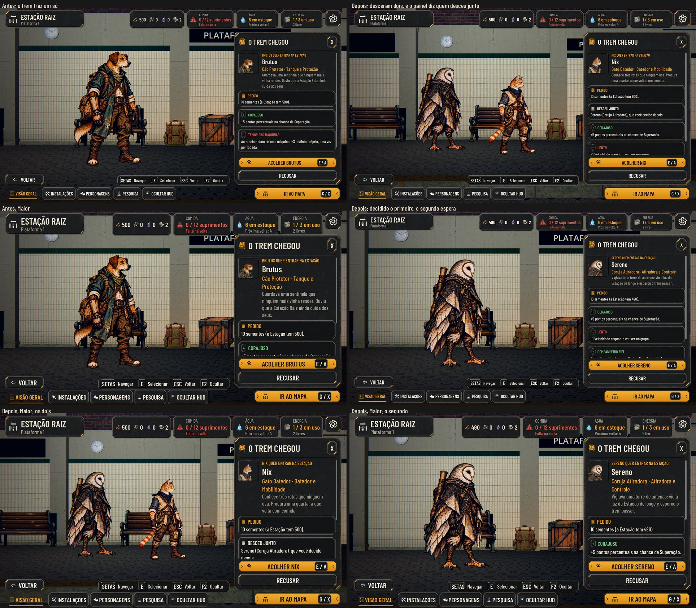

# O trem que não trava, nenhum personagem repetido e dois recrutas (#182, parte 1)

O pedido do Lucas (27/10): "Chegou um ponto em que o trem parou de vir." E a decisão dele: "nada de personagem
repetido no jogo".

O Mercador (a tela, as trocas e o nome) fica para quando o Lucas decidir as chances, os preços e o nome, que estão na
proposta da issue.

As fotos saem de `tools/capture_182.gd` (`--text-size=2`). O antes é a `main`.

## Por que o trem parava

O trem só vem na volta de uma expedição e, enquanto alguém espera na plataforma, não vem outro. Com o Alojamento
cheio, o animal que chegava não podia entrar e ia embora na partida, e o trem seguinte trazia outro animal que também
não cabia. Para quem joga, parecia que o trem tinha parado.

## O que muda

- **A casa cheia:** com o Alojamento cheio, o trem não traz animal. Se houver lugar de ajudante, traz o civil da
  fila; senão, ninguém (e a chance sobe para a volta seguinte, como antes). Quem espera já ia embora na partida.
- **Nenhum personagem repetido** (a decisão do Lucas):
  - o trem e o recrutamento (os voluntários e a barra de Admin) só trazem um rosto de recruta que ninguém do elenco
    usa, vivo, caído ou em recuperação, nem o animal que já espera no trem;
  - sem rosto livre da classe, não vem animal dela; o voluntário a caminho espera a vez, sem se perder;
  - o nome também não repete, nem entre os dois que chegam juntos;
  - quem já é repetido num save antigo fica como está, porque ninguém some;
  - quem é recusado libera o rosto, que pode voltar mais tarde com outro nome, porque é outra pessoa. O Lucas ainda
    vai decidir se ele volta; hoje volta.
  - Hoje há uma arte de recruta por classe: o cão, o gato, o sapo e a coruja, e, com o #187, o Guaxinim e o Tatu. Sem
    artes novas, o elenco para em 10: os 4 fundadores e 6 recrutas, com as classes liberadas. O pedido de variantes à
    Awesomic 1 está na issue.
  - O teste do #187 (`test_recruit_art`, "o trem pode trazê-lo") agora usa um save de verdade, porque a regra olha o
    elenco.
- **Às vezes descem dois** (proposta em `data/recruitment.json`: `SingleWeight` 60, `PairWeight` 15, ou seja, 20% das
  chegadas de animal):
  - o segundo só desce com lugar para os dois no Alojamento e com um rosto livre;
  - na plataforma, ele fica de pé ao lado do primeiro, e a câmera recua para os dois caberem;
  - o painel do primeiro diz quem desceu junto;
  - decidido o primeiro (acolhido ou recusado), o painel mostra o segundo, e o trem só parte depois dele;
  - sem decisão, os dois vão embora juntos na partida.
- **O save:** guarda o segundo (`train.next`). O save antigo abre com o trem de um só.

## Testes

- **`test_train_unique` (novo):**
  - acolhendo tudo o que o trem traz em 80 voltas, cada rosto chega uma vez, e depois não vem mais animal;
  - o recrutamento e os voluntários seguem a regra;
  - o rosto de quem espera fica reservado, e o do recusado fica livre de novo;
  - em 200 chegadas, os dois descem na proporção da tabela, com rostos, nomes e ids diferentes, e nunca sem lugar;
  - as decisões um de cada vez, e a partida que leva os dois;
  - o save e o save antigo;
  - a tela: o painel com "Desceu junto", o segundo na plataforma e, decidido o primeiro, o painel do segundo.
- **Ajustados para a regra nova:** `test_recruit_art` (o segundo cão não chega), `test_train_recruits` (a casa cheia
  não traz animal), `test_hero_jobs` e `test_station_rules`. Os testes que precisavam de vários heróis da mesma classe
  agora os põem direto no elenco, como um save antigo.

## Rodadas da QA

### Rodada 1: REPROVADO

**Médias, corrigidas:**
- **O rosto e o nome do segundo não ficavam reservados.** Com a barra de Admin, nasciam dois "Brutus" com o mesmo
  rosto. Agora os dois que esperam no trem (`waiting_recruits`) reservam o rosto e o nome.
- **O relatório e os avisos só citavam o primeiro.** O segundo ia embora sem aviso. Agora o nome de quem espera junta
  os dois ("Nix e Sereno") no relatório, no Próximo passo, na Preparação e na Sala. Os avisos estão no plural: "esperam
  no trem: se a equipe partir, vão embora".

**Baixas, corrigidas:**
- O `train_leaves` com laço podia travar num save inconsistente (o trem esperando sem candidato). Agora para no erro
  e encerra a visita.
- A troca na plataforma: o recusado volta andando ao vagão e some na porta; o segundo anda até o lugar do primeiro; e a
  câmera fecha nele.
- O id do segundo confere também o elenco.

`test_train_unique` passa a cobrir esses casos: o rosto e o nome reservados, os dois nomes nos avisos, o trem sem
candidato e a cena da troca.

### Rodada 2: REPROVADO

As cinco correções da rodada 1 passaram, com o Admin, a troca a 1x e a 2x, o painel fechado, a partida e o save no
meio.

**Médias, corrigidas:**
- **O trem partia com o recusado ainda andando.** Era o caso de recusar o primeiro e decidir o segundo logo em seguida:
  as portas fechavam e o vagão saía com o recusado ainda andando até a porta. Agora a partida espera ele entrar.
- **No Maior, o "Desceu junto" empurrava o pedido e o motivo do Acolher travado para fora da vista.** Agora ele vem
  depois deles.

**Baixa, corrigida:** abrir a Preparação logo depois da troca deixava o recusado cruzar a fila da equipe. A Preparação
agora o tira da cena.

**Fica:** o painel diz que o animal recusado "não volta", e a doc diz que o rosto pode voltar com outro nome. Isso
espera a decisão do Lucas.

### Rodada 3: REPROVADO

As correções da rodada 2 passaram:
- o recusado entra antes das portas fecharem, a 1x e a 2x;
- o Pedido e o motivo ficam à vista no Maior;
- a Preparação não cruza o recusado.

A espera da partida aguentou:
- fechar o painel;
- abrir um cômodo;
- reabrir o trem;
- salvar e sair no meio;
- rodar a 2x;
- recusar os dois rápido;
- acolher o segundo enquanto o primeiro volta.

**Média, corrigida:** durante a espera, o trem não contava como ocupado, e IR AO MAPA seguido de PREPARAR abria a
Preparação com o trem fechando as portas atrás da fila. Agora a espera marca a Estação (`departure_pending`), e o
`train_busy()` conta com ela, como acontece com um só candidato.

**Baixas, ficam:**
- No Maior, a caixa "Desceu junto" fica abaixo da dobra, porque o Pedido e o motivo vêm primeiro.
- Escolher um lugar no mapa durante a partida mostra "O trem está chegando…". Isso já acontecia antes, com um só
  candidato.

### Rodada 4: APROVADO

A QA rodou o `run_all` (76/76) e refez a partida e os casos da rodada 3. Também tentou prender o `departure_pending`:
- fechar o painel;
- sair e voltar à Estação no meio da espera e da partida;
- salvar e carregar;
- reabrir o trem;
- abrir um cômodo a 2x;
- trocar a velocidade;
- pausar;
- a noite pendente;
- um candidato só.

Em todos os casos, a flag desliga depois da partida, e a Preparação volta a abrir. Durante a espera, ela fica barrada.

**Baixa, fora desta entrega:** os erros "Lambda capture … was freed" na chegada do trem com `last_return` vazio. Eles
já aconteciam na `main` antes.
