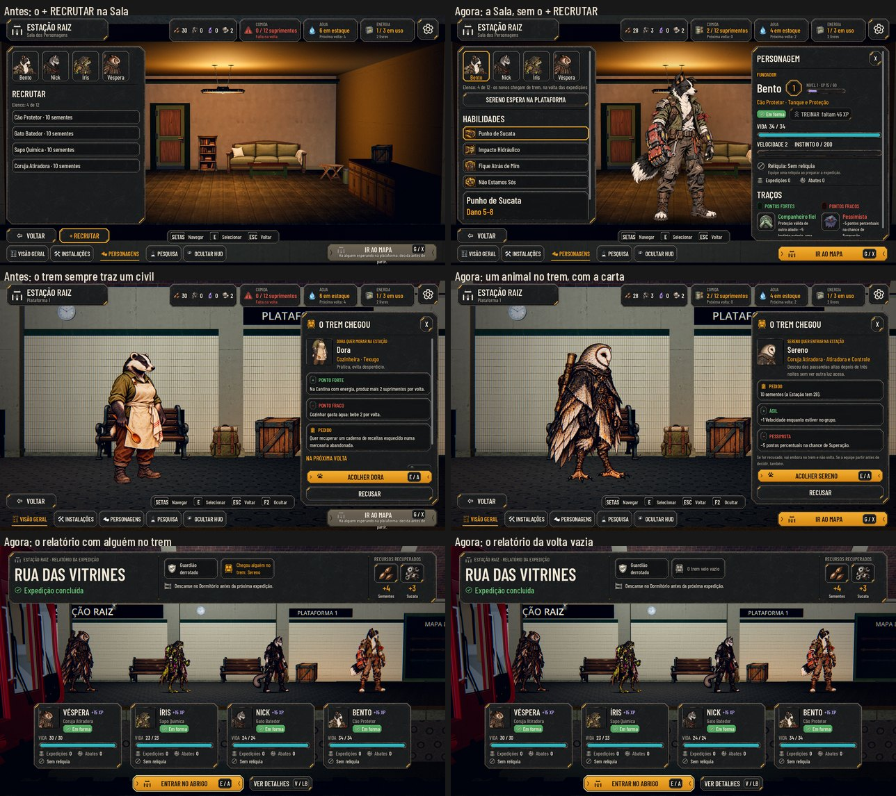

# O recrutamento pelo trem (#122)

O pedido do Lucas (26/10): "A parte de recrutamento tem que ser ali com um trenzinho chegando: às vezes vai ter gente,
às vezes não, para deixar isso mais difícil para o usuário também."

No Maior e no daltonismo: [screens.jpg](train-recruits/screens.jpg). As fotos saem de `tools/capture_122.gd`
(`--text-size=2`, `--colorblind`). O antes é o código da #123: a Sala com o + RECRUTAR e o civil no trem.

## O trem da volta

- **Na volta de cada expedição, o trem pode trazer:**
  - um animal de uma classe liberada (com arte de luta);
  - o próximo civil da fila;
  - ou ninguém.
- **A chance** fica em `data/recruitment.json`, como proposta:
  - 40% de chegar alguém;
  - mais 15 pontos a cada volta vazia, até 90%;
  - volta à base quando alguém chega;
  - com a fila dos civis e uma classe liberada, metade das vezes é um civil.
- **O sorteio sai da expedição:** a mesma volta traz sempre o mesmo, e salvar e voltar não troca quem chegou.
- **O animal** chega com um nome livre, os traços sorteados, a variação de arte e uma linha de onde veio. As linhas são
  duas por classe, em `data/recruitment.json`, e seguem as culturas de espécie da lore (§15) sem tocar na escada de
  revelações.

## Na plataforma

- Quem chegou desce do trem e espera. O painel mostra:
  - o rosto, a classe e de onde veio;
  - os traços, com + em verde nos bons e − em vermelho nos ruins;
  - o que pede.
- **Aceitar** custa 10 sementes (`recruit.Cost`, o mesmo preço do + RECRUTAR de antes). Vem de graça enquanto o elenco não
  fecha uma equipe de quatro, como o voluntário de antes.
- **Recusar** manda embora no trem, e quem chegou não volta. O civil recusado continua voltando ao fim da fila, como antes.
- **Ninguém decidiu:** alguém esperando não trava mais a partida. Se a equipe partir, quem esperava vai embora no trem.
  A plataforma avisa: "Fulano espera no trem: se a equipe partir, vai embora."
- **A casa cheia** (12 animais): o trem ainda traz alguém, mas Acolher fica travado, com o motivo ("A Estação está cheia
  (12 de 12): não há lugar para Sereno agora."). Abrir lugar chega com a #119.
- **Acolher travado** (sem sementes, casa cheia) fica sem a tecla, e Recusar sai do foco do teclado e do controle: a
  tecla de Acolher nunca manda embora sem querer. Recusar continua no clique e no toque, e Esc fecha o painel.
- **O que pede e o motivo** ficam logo abaixo do nome, antes dos traços: no texto Maior, à vista sem rolar.
- **Com o trem chegando**, a equipe não sobe para a plataforma ("O trem está chegando à plataforma: espere ele parar.").

## Os avisos

- **O relatório da volta** ganha um chip: "Chegou alguém no trem: Sereno", ou "O trem veio vazio".
- **O Próximo passo** diz "Chegou alguém no trem", com o nome (decidido, o card sai).
- **A Visão geral** mostra quem espera de pé na plataforma, também depois de a equipe ter subido e voltado.
- **Na Sala dos Personagens**, o + RECRUTAR saiu. No lugar fica a linha do elenco ("Elenco: 5 de 12 · os novos chegam de
  trem") e, com alguém esperando, o botão até a plataforma.
- **A barra de Admin (F1)** ganhou "Trazer um animal no trem" e "Trazer um civil no trem".

## Textos

- **O evento do guaxinim** dizia "dá para recrutar um guaxinim no Alojamento". Agora diz só que a classe foi liberada.
  O guaxinim ainda não tem arte de luta e não chega no trem.
- **O Alojamento** passa de "Elenco, recrutar, tratar trauma e relíquias" para "Elenco, treino, trauma e relíquias".

## Testes

- **`test_train_recruits` (novo):**
  - o sorteio: a mesma volta dá o mesmo, e em 60 voltas umas trazem alguém e outras não, animais e civis;
  - a chance que sobe a cada volta vazia e zera;
  - o animal que chega: a classe, o nome, os traços e de onde veio, e a classe sem arte fora;
  - aceitar com e sem sementes, o custo e o grátis, e recusar;
  - não decidir, para o animal e para o civil;
  - a casa cheia;
  - o save no meio e o save antigo;
  - o relatório e o Próximo passo;
  - a tela: a Sala sem o + RECRUTAR, o painel do trem e ele de pé na plataforma.
  - o id reservado na chegada que a Admin usou antes;
  - a partida esperando o trem parar, quem espera saindo da fila da partida e voltando à plataforma;
  - Acolher travado sem a tecla, e as teclas (seta, E, Enter) sem mandar embora.
- **`test_station_rules`, `test_full_journey` e `test_keyboard_navigation`** fixam o trem em 100% de civil (eles
  conferem a fila dos civis); `test_train` pede um civil.

## Rodadas da QA

### Rodada 1: REPROVADO

**Alta, corrigida:** com Acolher travado, o foco ia para Recusar, e a tecla impressa em Acolher (E, Enter, A) mandava o
recruta embora para sempre. Agora Acolher travado fica sem a tecla, e Recusar sai do foco do teclado e do controle.

**Médias, corrigidas:**
- **Abrir a partida durante a chegada do trem** fazia o recruta descer no meio da fila. A partida espera o trem parar.
- **Depois de abrir e fechar a partida**, a plataforma ficava vazia com o Próximo passo dizendo que ele espera. Quem
  espera volta para a plataforma, e a Visão geral o mostra.
- **No Maior**, o preço e o motivo ficavam abaixo da rolagem, com Acolher apagado. Eles vêm antes dos traços agora.
- **"Abra lugar para X ficar"** prometia uma ação que ainda não existe. O texto só constata: "não há lugar para X agora".

**Baixas, corrigidas:**
- O Próximo passo com o nome vazio enquanto o trem parte.
- O id duplicado quando a Admin recrutava da mesma classe antes de Acolher.
- A linha da classe que passava da borda no Maior.
- Os pronomes no masculino em algumas origens e no aviso de recusa.

**Fica:** os testes que fixam o trem em 100% de civil restauram a tabela no fim; um teste que parar no meio deixa o
100% para os seguintes.

### Rodada 2: APROVADO

A QA refez os casos com scripts próprios, sem a janela e no xvfb:
- Acolher travado com setas, Tab, E, Enter, Espaço e o A do controle;
- a partida negada com o trem chegando ou partindo;
- quem espera de volta à plataforma pelos dois caminhos;
- o Maior com a casa cheia;
- o Próximo passo durante a partida do trem.

**Baixas, corrigidas depois:** o aviso de recusa sem pronome e o "lá" repetido numa origem.

**Ficam:**
- Com Acolher travado, nada no painel recebe o foco; as setas vão para a barra de cima, sem risco de recusar.
- O aviso "Lambda capture ... was freed" ao carregar a Estação.
