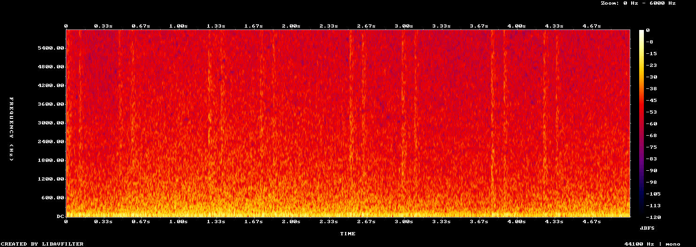

# O som do trem na passagem do vagão (#133)

O pedido do Lucas (26/10): "Barulho de trem quando estiver na tela de carregamento do trem."

O espectro de `audio/station/train_ride.ogg` (5 s). Embaixo, o ronco do motor (46, 92 e 138 Hz) subindo e descendo devagar.
As faixas verticais são o "ta-dum" das rodas nas emendas dos trilhos: dois truques por vagão a cada 1,25 s. Entre elas,
o chiado das rodas.

Não há capturas de antes e depois: a passagem fica igual na tela, e só o som muda.

## O som

- **O laço** sai de `tools/synth_sounds.py` (`train_ride`), feito do zero por síntese, de domínio público (CC0), como os
  outros sons de lá. Os créditos estão no README.
- **Sem emenda:** o rabo do ruído entra misturado no começo, e o ritmo e o ronco fecham um número inteiro de batidas em
  5 s. Na emenda, o salto entre a última e a primeira amostra fica no tamanho de um passo comum do sinal (0,10, com o
  p99 do arquivo em 0,10 e o máximo em 0,28).
- **O volume** vai ao alvo do Ambiente (-26 LUFS, ganho de -7 dB na tabela de mixagem). Toca no canal do Ambiente, então
  segue o volume do Ambiente nas Opções.
- **Os outros sons não mudam:** rodar a ferramenta de novo gera os mesmos arquivos byte a byte, e a tabela de mixagem só
  ganha a linha nova.

## Onde toca

- **A partida no vagão (#75):** o trem saindo da plataforma (`train_departure`) quando o cartão abre, o laço por baixo do
  passeio e do título e, sem pular, a freada (`train_brake`) quando o cartão fecha na fase.
- **A volta à Estação (#76):** o cartão da Estação com o laço. A freada, o sino e a chegada já tocam na plataforma, com o
  trem entrando.
- **O laço entra com o cartão** (0,3 s, pelo relógio) e sai com ele (no fade de 0,25 s que fecha o cartão). A cena
  seguinte só monta depois de o laço chegar ao volume dele: o quadro da montagem trava o jogo (de 1,5 a 9 s, conforme a
  máquina), e o som tocado nesse tempo é o do volume certo.
- **A partida do trem** (6 s) sai junto com o laço: não passa para a fase nem toca por cima da freada.
- **Pular** corta tudo em 0,15 s, sem a freada.
- **Com "Reduzir efeitos",** o vagão sai da tela, mas o som toca igual.

## Testes

- **`test_train_sound` (novo):**
  - o laço existe e está na mixagem;
  - os cartões da partida (partida, laço e freada) e da volta (só o laço);
  - o laço tocando no canal do Ambiente com o cartão, já no volume dele no último quadro antes de a Estação montar, e
    saindo no fim, com a freada;
  - pular cortando o laço e a partida, sem a freada;
  - o Ambiente zerado deixando o canal mudo, e o volume escolhido valendo.
- **`test_passage` e `test_departure`** seguem verdes.

## Rodadas da QA

### Rodada 1: REPROVADO

**Médias, corrigidas:**
- **A partida do trem (6 s) não saía ao pular nem com "Reduzir efeitos":** tocava a -2 dB na fase e por cima da freada.
  Agora ela sai junto com o laço.
- **Na volta, o laço quase não se ouvia:** o fade de entrada andava no tempo do jogo e parava em -44 dB no quadro que
  monta a Estação. Agora entra pelo relógio, em 0,3 s, e chega ao volume antes da montagem; o teste confere isso.
- **O teste deixava uma pasta de save:** agora a apaga no fim.

**Baixa, fica:** a partida toca uns 4 dB acima do laço, de propósito (registrado em `docs/audio.md`).

### Rodada 2: REPROVADO

A partida ao pular e com "Reduzir efeitos" e a pasta de save ficaram resolvidas.

**Média, corrigida:** na volta, a Estação montava antes de o fade de 0,3 s terminar, e o laço tocava entre -18 e -26 dB
durante a montagem; o teste passava assim mesmo. Agora o `GameFlow` só monta a cena seguinte com o laço no volume dele
(`sound_settled`), e o teste guarda o volume do último quadro antes da montagem (sem a correção, ele falha com -17 dB).

### Rodada 3: APROVADO

A QA refez a volta pela retirada e pela derrota e a partida com "Reduzir efeitos", sem janela e no xvfb: o laço está no
alvo (-9 dB) antes da montagem. As passagens sem som têm o mesmo tempo da `main`.
