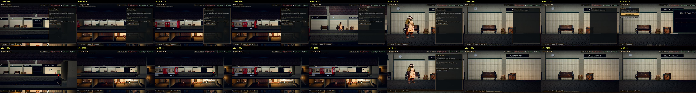
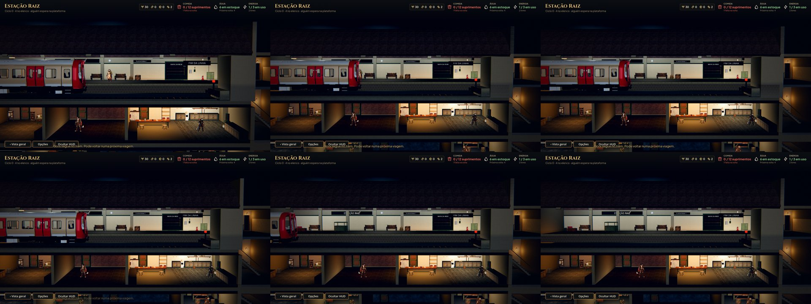

# O trem da Estação na ordem da cena (#61)

Gravado com `tools/capture_train.gd` (a volta com um candidato: a Estação abre o trem sozinha; `--slow=0.25`, uma
foto a cada 0,5 s de jogo). O registro de cada gravação, com os sons e os passos da cena: [antes](train/events-before.txt)
e [depois](train/events-after.txt).

Antes, o painel "O trem chegou" abria por cima da chegada e o sino só tocava na parada. Depois, o sino avisa antes do
freio, nada cobre a cena e o painel abre só com a câmera no candidato.

Na recusa, o candidato volta à porta, o sino toca, as portas fecham e o trem acelera para o túnel, à vista (antes a
câmera ficava no lugar dele e a partida acontecia fora do quadro; o recusado sumia).
