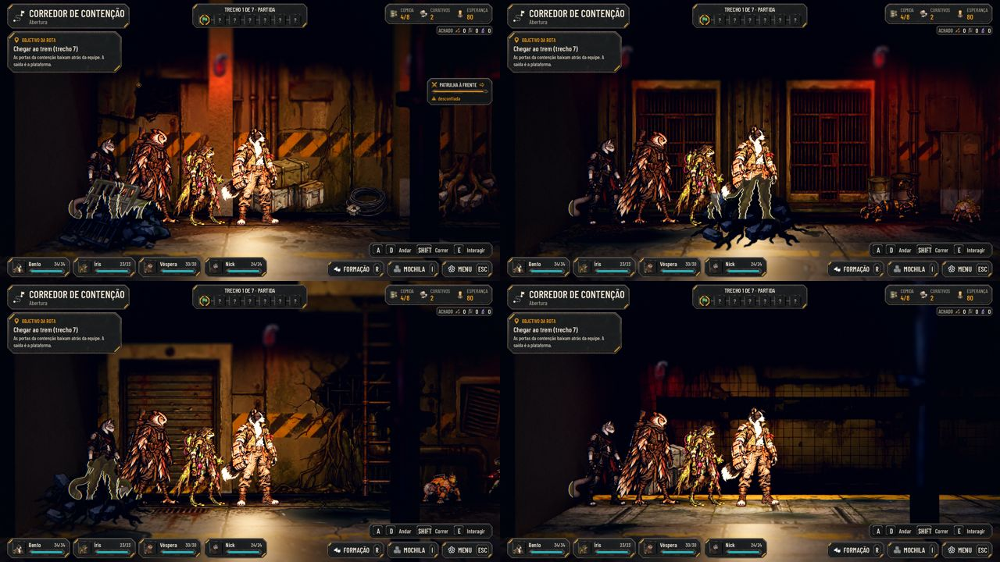
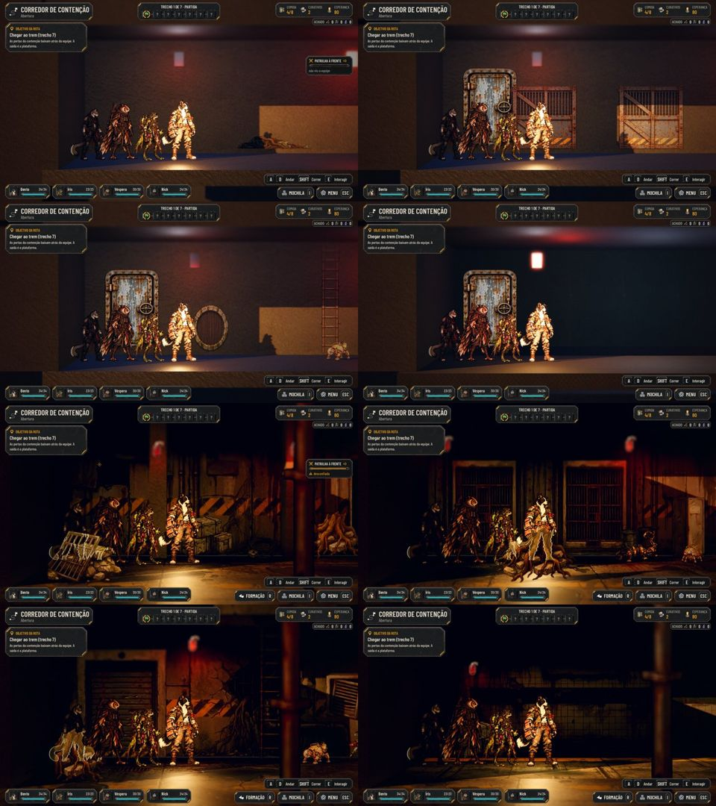

# O Corredor de Contenção: o mapa do tutorial (#147)

Fecha #147. O mapa agora é o do PR #173 (a planta e a arte `T_TU*`/`T_TUX*` da Awesomic), com a camada de jogo por
cima. O fluxo do tutorial (os textos, as dicas, a recompensa, a chegada) é da #144, que vem por cima deste.

## O mapa

- `data/scenarios/ContainmentCorridor.json` é gerado por `python tools/build_containment_corridor.py` a partir de
  `docs/design/tutorial/map/ContainmentCorridor.json` (o mapa do #173). A planta, as peças, os materiais e as luzes ficam
  como a Awesomic entregou; o script só acrescenta o que `scenario_world.gd` lê ("Para integrar",
  `docs/design/tutorial.md`).
- **As zonas** (10 m cada; a última, 12 m): Corredor (a partida e a luta 1), Celas (o Nick, a luta 2 e o armário de
  manutenção), Rota do Nick (a porta de segurança, o duto, a escada e a luta 3) e Plataforma (o vagão e o embarque).
- **As lâmpadas:** os 9 cards acesos (`T_TU08_Lit`) trocam pelo apagado (`T_TU08`) e as 20 luzes vermelhas deles caem
  junto, cada lâmpada na sua fase (0,6 s acesas, 0,4 s a 25%; acesas com "Reduzir efeitos").
- **Os interativos:** o armário (`TUX02`) é a busca (1 curativo e 1 comida); o painel (`TUX03`) fica acionado da sala
  das celas em diante; a porta de segurança (`TUX01`, x 43,8) é a única porta: baixa atrás da equipe quando ela entra
  na Rota do Nick, e não há volta.
- **O trem:** o vagão (`T_TU10`) e as 4 luzes frias dele ficam num nó `Metro` (o campo `node` das peças e das luzes),
  escondido até a equipe entrar na plataforma; aí ele entra no fosso. O embarque é na porta aberta da direita, no fim da
  plataforma (x 75,0), e leva à Estação pela passagem do vagão (#75).
- **A luz do lugar:** `street.gd` (`SITE_LIGHT`) dá ao corredor um ambiente baixo e quente, a névoa vermelha escura e o
  reflexo no piso molhado (SSR) mesmo sem chuva.

## A jornada

- A fase "tutorial" (`AHTutorial`, `data/tutorial.json`) joga pelo corredor de sempre, mas fica fora de
  `AHJourneyRules.PHASES`: não aparece no Mapa da Rede nem no "Jogar de novo".
- **Sete trechos, numa ordem nova:** a partida, a luta 1, o Nick, a luta 2, a busca, a luta 3 e o trem. Antes a busca
  vinha antes da luta 2; no mapa do #173 o armário e o painel ficam no fim da sala das celas, então a luta 2 vem antes
  deles.

## O que ficou de fora do "Para integrar" (para o Lucas)

- **2:** os véus de névoa (`MIST_SHADER`).
- **7:** a sombra das lâmpadas no Compatibility.
- **8:** a luz de preenchimento das lutas tingida com a cor do lugar.
- **9:** o primeiro plano em alpha blend.
- `tools/sync_scenarios.py` não mudou: é a lista do export da Unreal, e o corredor não vem de lá.

## Testes

- `tests/test_tutorial_map.gd` (96): o contrato do mapa (as zonas, a porta, o painel, o trem), a fase fora do Mapa da
  Rede e a jornada pela cena de verdade (as lutas, a porta que baixa, o Nick, sem volta, o vagão escondido até chegar e
  o embarque).
- `tools/capture_scenarios.gd --maps=ContainmentCorridor`: as 4 zonas no piso e na faixa (8 de 8).
- A captura da rua (`-- --capture=`), com a colisão: `08-collision-car` e `09-collision-facade` PASS.

## Antes e depois

## QA

| Rodada | Veredito | O que a QA achou | Como ficou |
|---|---|---|---|
| 1 | REPROVADO | **Médias:** o Menu deixava voltar à Estação e abandonava a abertura; o objetivo dizia "Vencer o guardião"; o vagão aparecia parado durante o fade e depois sumia para chegar; o embarque não usava a passagem do vagão; o céu atrás das paredes e o escuro na noite real. **Baixas:** a plaqueta com o clima, o painel parado, o som da porta, o ícone do trem, os nomes das zonas fora do PO, o Pipoco e a Faísca soltos na lore | Todas corrigidas |
| 2 | REPROVADO | **Alta:** com o Robô, a luta 3 matava a dupla com a vida que sobrava da luta 2, e o teste escondia isso curando entre as lutas | A luta 3 voltou ao Rastreador e o teste parou de curar |
| 3 | REPROVADO | **Alta:** o Bento ainda morria em 2 de 5 percursos sem cura | As lutas 2 e 3 ficaram mais leves (o Rastejante sozinho, o Drone de Expurgo) |
| 4 | APROVADO | 10 percursos andando, sem cura: as três lutas vencidas, ninguém caiu, a menor vida no fim foi 11 | — |

## Para o Lucas

- O ícone do trecho do trem é o do fim do corredor (o do guardião), até haver um ícone de trem.
- As capturas em Baixo e em Ultra das portas e do embarque ficam para a máquina com placa de vídeo: aqui a Godot roda
  só no Compatibility, por software.
