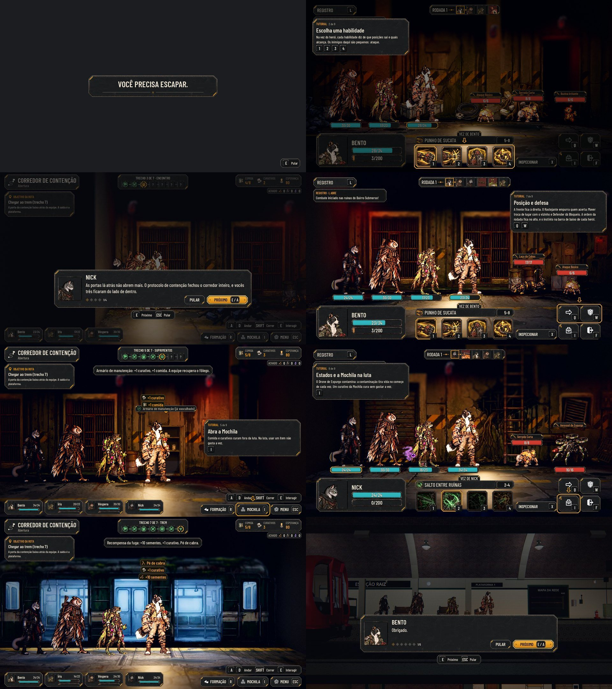

# O tutorial da abertura (#144)

A campanha nova começa pela abertura do arco (`docs/narrative/bento-nick-arc.md`; as decisões em
`docs/qa/tutorial-arc.md`): o Bento, a Íris e a Véspera presos no Corredor de Contenção (#147), o Nick, que volta para
ajudar, três lutas curtas, a busca, o trem e a chegada à Estação com a recompensa. A visita guiada da Estação é a
#145, por cima desta.

## O que muda

- **A campanha nova** (o título, e também a Nova campanha da Estação e da rua) pergunta "Como começar?": pela abertura
  (o padrão) ou Pular tutorial. Pular dá o mesmo estado de quem joga até o trem: a recompensa, o elenco e o relatório.
- **A abertura:** o cartão "Você precisa escapar." (o quadro da tirinha fica em `data/tutorial.json`, `opening`) e o
  Corredor de Contenção com o Bento, a Íris e a Véspera (`StartTeam`).
- **Os trechos:** a partida, a luta 1, o Nick, a luta 2, a busca, a luta 3 e o trem. O Nick entra no encontro
  (`JoinTeam`), numa conversa com retrato (a caixa do briefing, #88). A busca dá 1 curativo, 1 comida e o fôlego: quem
  está ferido recupera 35% da vida máxima (`Search.Heal`), com a linha "A equipe recupera o fôlego.". Quem passa pelo
  armário sem vasculhar recebe o mesmo fôlego, com a mesma linha, ao chegar à zona da luta do Drone; ele vem uma vez só.
- **As dicas do tutorial** (`AHTutorialGuide` e `AHTutorialHint`, no kit): nove passos de `data/tutorial.json`, uma de
  cada vez, cada uma com o destaque e as teclas:
  - andar; a habilidade e o alvo na luta 1 (a primeira escolha trava as outras ações e escurece o resto); a patrulha
    depois do Nick; a posição e a defesa na luta 2; vasculhar e a Mochila depois dela; os estados e o item na luta 3;
    o embarque;
  - a dica some quando o jogador faz o que ela pede, sai da frente com uma janela aberta e não cobre as cabeças;
  - as dicas de primeira vez (`Tips`) ficam caladas durante a abertura e contam como vistas no fim.
- **Ninguém cai:** nas lutas do tutorial a vida do herói para em 1, e a contaminação e o sangramento sempre pegam nele
  (`AHTutorial.prepare_fight`); quem foge recomeça a mesma luta com a equipe inteira.
- **As lutas** (só inimigos que já existem; o reforço só do tutorial fica em `Boost`, e `enemies.json` não muda):
  - luta 1: Broto, Faísca e Pipoco, com o Broto e a Faísca mais fortes e mais rápidos (+4 de dano, +3 de velocidade);
  - luta 2: o Rastejante de Cabos com o Broto atrás;
  - luta 3: a Faísca na frente do Drone de Expurgo, que age logo (+8 de velocidade) e contamina.
- **O fim:** a recompensa à vista (+10 sementes, +1 curativo e o pé de cabra), a passagem do vagão (#75), a chegada na
  plataforma (#76) com o debriefing do Bento e do Nick, do "Obrigado." ao "Só por uma noite.", e o relatório com os
  quatro fundadores.
- **O save** guarda o ponto (`campaign.tutorial`): fechar no meio e voltar retoma dali, com as dicas já vistas.
- **Os textos** em português e inglês (`data/i18n/en.po`).

## As capturas

`tools/capture_tutorial.gd`, na ordem da jornada (em `docs/qa/tutorial/`):

| | | |
|---|---|---|
| [01 A campanha nova](tutorial/01-new-campaign.jpg) | [02 O cartão](tutorial/02-opening-card.jpg) | [03 Andar](tutorial/03-walk-hint.jpg) |
| [04 A habilidade](tutorial/04-fight1-ability-hint.jpg) | [05 O alvo](tutorial/05-fight1-target-hint.jpg) | [06 O Nick](tutorial/06-nick-arrives.jpg) |
| [07 A patrulha](tutorial/07-patrol-hint.jpg) | [08 A posição (luta 2)](tutorial/08-fight2-position-hint.jpg) | [09 A busca](tutorial/09-search-hint.jpg) |
| [10 A Mochila](tutorial/10-bag-hint.jpg) | [11 O item (luta 3)](tutorial/11-fight3-item-hint.jpg) | [12 O trem](tutorial/12-train-hint.jpg) |
| [13 A recompensa](tutorial/13-reward.jpg) | [14 O vagão](tutorial/14-wagon.jpg) | [15 A chegada](tutorial/15-arrival-debriefing.jpg) |

## Testes

- `tests/run_all.gd` inteiro, com a paridade 48/48.
- `tests/test_tutorial.gd`: pular dá o mesmo estado de jogar; `complete()` fora da jornada recusa; a vida mínima; o
  título até o cartão e o mapa; a jornada pela cena de verdade (cada dica, as travas, Voltar na mira, a dica sob o
  Menu, o Nick, a luta 2, a busca (e o fôlego dela) e a Mochila, o save no meio e o Continuar, a fuga que recomeça, as três lutas sem
  ninguém cair, o trem, a recompensa e a chegada); a Nova campanha da Estação pelo título.
- `tests/test_tutorial_balance.gd`: as três lutas em sequência, como no jogo (a vida passa de uma para a outra, com o
  fôlego da busca antes da 3), com sementes fixas, na política ingênua e na automática; trava a luta 1 entre 10% e
  25%, a contaminação em 90% ou mais e a vida 1 nas lutas 2 e 3 em no máximo 10% (os números em
  `docs/qa/tutorial-arc.md`).
- `test_title`: a janela "Como começar?" nas campanhas novas.

## QA

| Rodada | Veredito | O que a QA achou | Como ficou |
|---|---|---|---|
| 1 | REPROVADO | **Médias:** a Nova campanha da Estação e da rua pulava o tutorial sem a recompensa; a dica ficava por cima do Menu, das Opções e da Mochila; a dica cobria as cabeças na luta e no trem; Voltar na mira deixava a dica do alvo e soltava as ações; "a barra roxa" do instinto; passar pelo armário pulava a dica da patrulha; a fala do Bento perdia o motivo do arco (§3). **Baixas:** as setas em inglês, as teclas no toque, o erro do foco adiado, os destaques | Todas corrigidas |
| 2 | APROVADO | As observações baixas (o erro do foco, a dica da busca que ficava, o aviso do trem sob a dica) | Corrigidas depois do veredito |
| 3 (o arco) | REPROVADO | A luta 1 fácil demais; a contaminação da luta 3 em metade das vezes; o som da porta onde não há porta; esta página e as capturas com o elenco antigo; o pilar do primeiro plano tapando a Véspera | Corrigidas (os detalhes em `docs/qa/tutorial-arc.md`) |

## Para o Lucas

- **Fora deste PR:** a linha do Registro "Combate iniciado nas ruínas do Bairro Submerso!" é fixa no motor (e na
  paridade) e aparece em qualquer luta.
