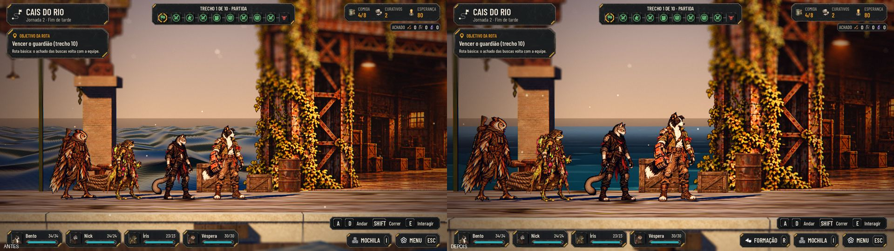
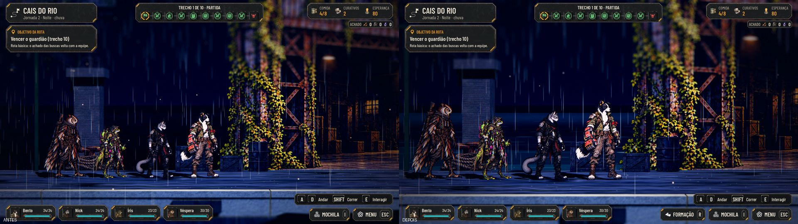
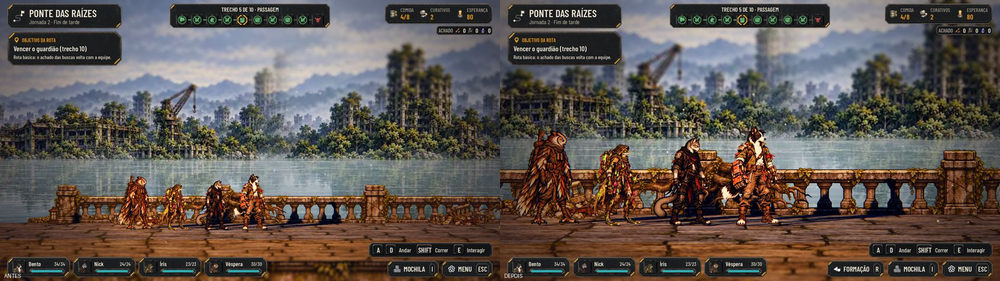
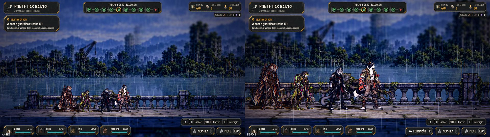
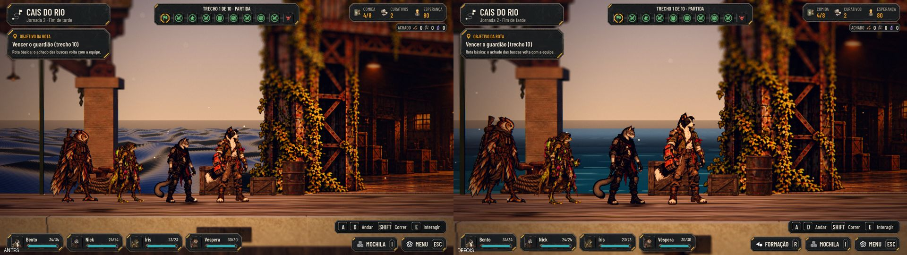
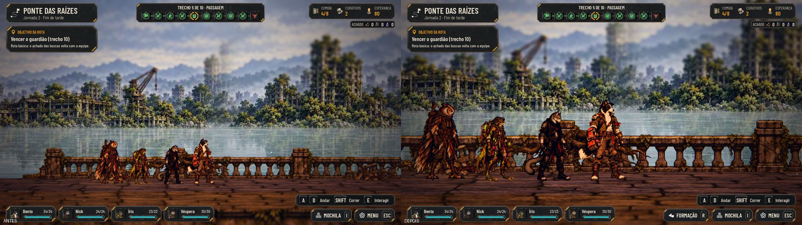

# A água pintada do Cais e da Ponte das Raízes, e a câmera da Ponte (#140)

## O que muda

- **A água do chão** (`shaders/water_painted.gdshader`, com a parte comum em `water_painted.gdshaderinc`), na linguagem
  pintada dos cards, sem luz própria e com a cor do clima e da hora:
  - faixas de cor em degraus (clara perto da margem, escura no fundo);
  - ondinhas desenhadas, traços curtos que andam devagar, maiores com a distância para não sumirem com a câmera rente;
  - um brilho que pisca nas cristas;
  - a espuma na margem (a beira do cais, a frente da ponte) e em volta das estacas do Cais e dos pilares da Ponte
    (`foam_points` no material do mapa);
  - um balanço de poucos centímetros na malha e a névoa da distância, que leva a água de longe para a cor do horizonte.
- **O fundo da Ponte:** o panorama pintado (`scenario_card_water.gdshader`) fica igual acima da linha d'água; abaixo
  dela, a água da pintura se mexe: as ondinhas quebram a pintura na horizontal e os traços e o brilho da água do chão
  passam por cima, com menos detalhe e mais névoa para o horizonte. O céu, as margens e a ponte continuam.
- **"Reduzir efeitos"**: a água anda a 40% e não pisca (muda na hora, pelas Opções).
- **A câmera da Ponte** é a dos outros cenários (`EXPLORE_CAMERA.scenario`, da #129):

  | | Distância até o líder | Altura sobre o líder |
  |---|---|---|
  | Ponte, antes | 28,2 m | 2,9 m |
  | Cais, antes | 19,1 m | 1,9 m |
  | Ponte e Cais, agora (e os outros cenários) | 15,9 m | 1,6 m |

- As cores da água ficam no material de cada mapa (`surface_color`, `mid_color`, `deep_color`, `ripple_color`,
  `foam_color`, `horizon_color`), para ajustar sem mexer no shader. O Depósito e os Dutos seguem com a água de antes.

## Antes e depois

| | |
|---|---|
| Cais, fim de tarde  | Cais, noite com chuva  |
| Ponte, fim de tarde  | Ponte, noite com chuva  |
| Cais, no Baixo  | Ponte, no Baixo  |

O movimento, em 4 quadros a 0,4 s: [o Cais](water/RiverDock-sequence.jpg) e [a Ponte](water/RootBridge-sequence.jpg).

## Testes

- `tests/run_all.gd`: 65 de 65, com a paridade 48/48.
- `tests/test_water.gd` (novo): a água pintada nos dois mapas, com a espuma; o panorama com a água viva; "Reduzir
  efeitos" na hora e de volta; a câmera da Ponte igual à do Cais e à do Abrigo.
- `tools/capture_140.gd`: as capturas acima (também roda na main de antes) e as medidas da câmera.

## Para o Lucas

- **O desempenho no Baixo e no Ultra** com placa de vídeo fica com o Orquestrador PC: a nuvem só roda o
  Compatibility, por software, e lá o quadro inteiro custa uns 133 ms com ou sem a água. O shader é leve (sem textura
  de tela nem de profundidade; um laço de até 16 pontos de espuma).
- **Os personagens e a água:** nos dois mapas ninguém pisa na água, então o anel de espuma em volta de quem toca a água
  ficou só para as estacas, os pilares e a margem.
- Este PR vem por cima do da #129 (a câmera nova).
