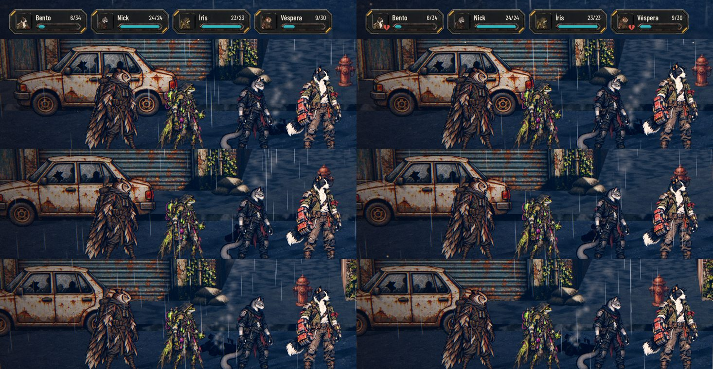

# O herói ferido (#194)

## A regra (`scripts/flow/wounded.gd`, `AHWounded`)

Os números ficam em `data/wounded.json`, para o Lucas ajustar:

- **Ferido** (`AHWounded.is_wounded(hero)`): vivo e com a vida abaixo de 40% da máxima (`Threshold`), ou Caído em
  recuperação (#118/#121), mesmo com a vida cheia. Uma função só, para a exploração, a Estação e a HUD.
- **O passo** (`AHWounded.speed_factor`): 70% da velocidade (`SpeedFactor`).
- **A pose** (`AHWounded.pose(idle)`): o `wounded.webp` da pasta da arte do herói, no canvas e na âncora do idle (a
  entrega do Codex, PR #209). Sem o arquivo, o idle de pé. A pose troca sozinha quando a arte entrar.

## Na exploração

- **A fila anda no passo do mais ferido** (`party_speed_factor`): ela anda junta, então com alguém ferido todos andam
  a 70%.
- **O mancar** de quem está ferido, andando:
  - um passo sobe inteiro e o outro só 55% (`LimpDip`);
  - o corpo pende até 3,5° para o lado do passo bom (`LimpTilt`);
  - a respiração fica duas vezes mais funda e mais lenta (`BreathDepth`).
- **"Reduzir efeitos" ligado:** só a pose e o passo mais lento, sem o balanço.
- **A pose de ferido**, quando a arte existir, troca na hora em que o herói fica ferido ou deixa de ficar (a vida muda
  com a luta, a comida e o curativo).

## Na HUD da exploração

O coração rachado (`state_wounded`, o da Sala dos Personagens) no canto do retrato do ferido, com a dica "Precisa se
recuperar". Some quando a vida volta acima do limite.

## Na Estação

A chegada do trem fica em `station.gd`, área do Claude 1: ele usa a mesma `AHWounded.is_wounded` e a `AHWounded.pose`
(combinado pelo Orquestrador).

## Testes

- `tests/test_wounded.gd` (novo, 20 verificações):
  - o limite (abaixo de 40% ferido, no limite não), o Caído em recuperação, o morto e o herói ausente;
  - a fração da velocidade e a pose (o arquivo da pasta com o canvas e a âncora do idle; sem o arquivo, o idle);
  - na rua: a fila no passo do ferido, o ferido mancando e os inteiros retos, sem o balanço com "Reduzir efeitos";
  - o aviso na HUD só no ferido, e fora quando a vida volta;
  - o save: a vida baixa volta com ele.
- `tests/run_all.gd` inteiro.
- `tools/capture_194.gd`: a Rua com o Bento a 20% e a Véspera a 30%, parada e andando; roda também na `main` de antes.
